# OpnDoor

Door scheduling and everyday access control for **UniFi Access**, built to be simple enough for
anyone. People sign in, see only the doors they're allowed to use, open them, and set when they
unlock and lock again: one-off events, weekly hours, closures, or a booking calendar that does it
automatically. It also covers lockdown and evacuation, live door cameras, floor-plan maps, door
activity, visitor passes, lobby and room screens, alerts and emailed reports.

Runs as a small Docker container (FastAPI + SQLite) with a one-command installer. Images are built
by GitHub Actions and published to GHCR.

## Screenshots

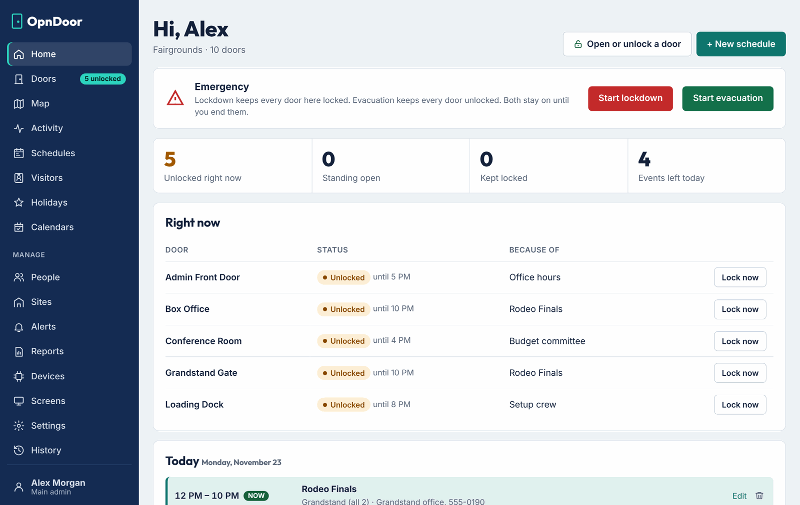

<table>
<tr>
<td width="50%">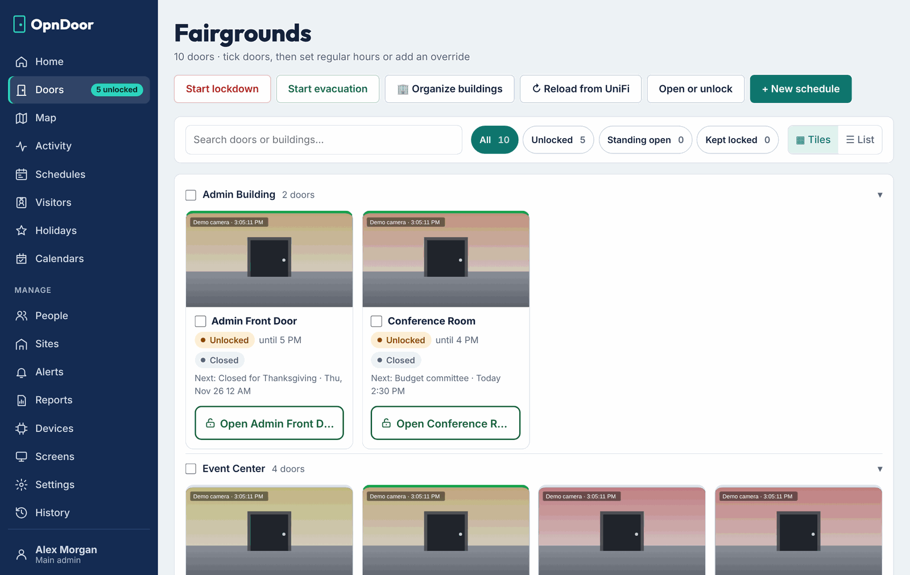<br><b>Doors</b>: every door as a tile with its camera and its own Open button.</td>
<td width="50%">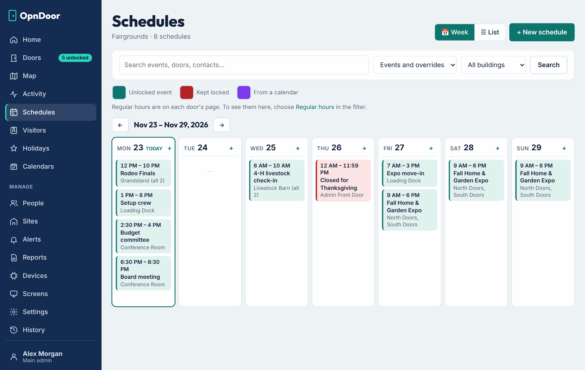<br><b>Schedules</b>: the week at a glance; click an event to change it.</td>
</tr>
<tr>
<td>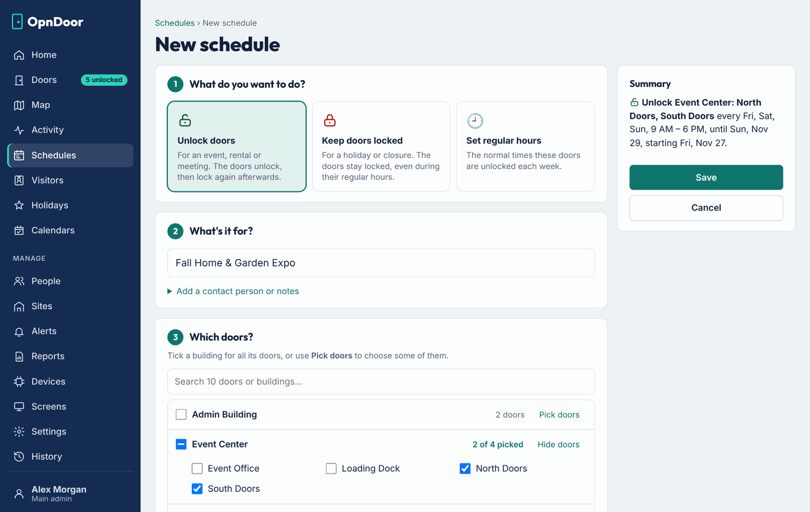<br><b>New schedule</b>: what, which doors, when. The summary says it in plain words.</td>
<td>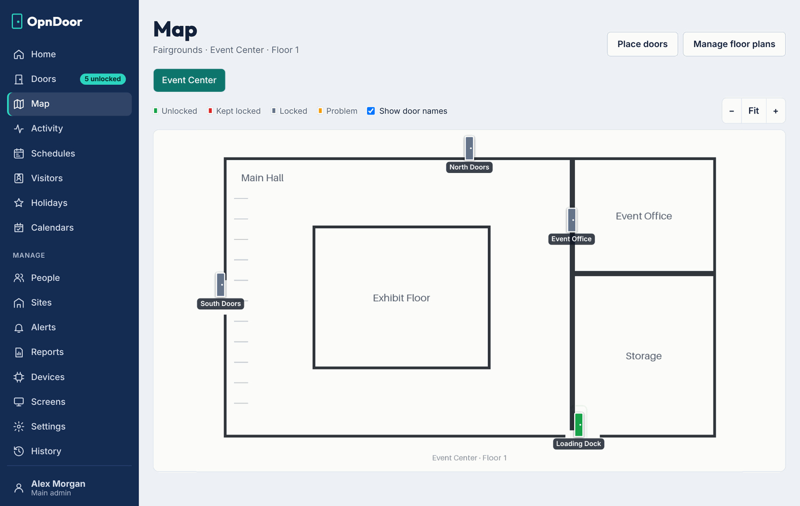<br><b>Map</b>: doors on your floor plans, coloured by what they're doing.</td>
</tr>
<tr>
<td>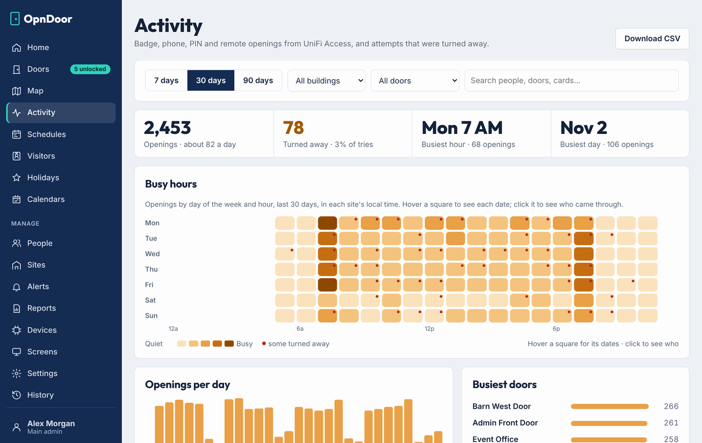<br><b>Activity</b>: busy hours, busiest doors and who came through, from UniFi Access.</td>
<td>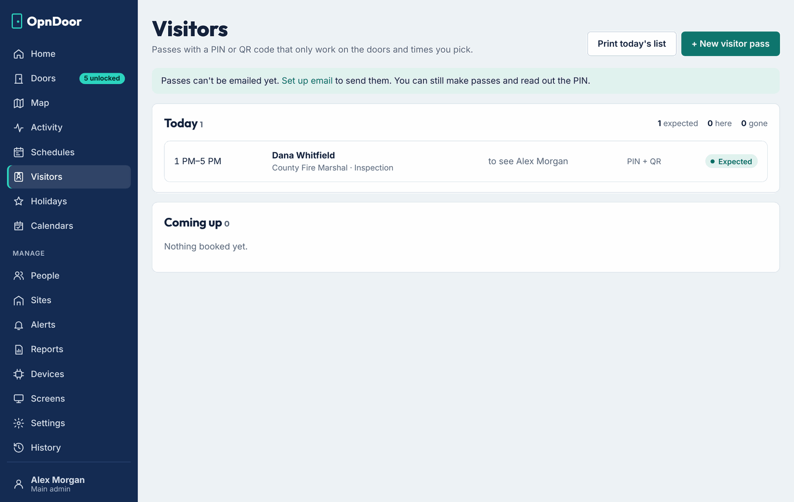<br><b>Visitors</b>: passes with a PIN or QR code for chosen doors and times.</td>
</tr>
<tr>
<td>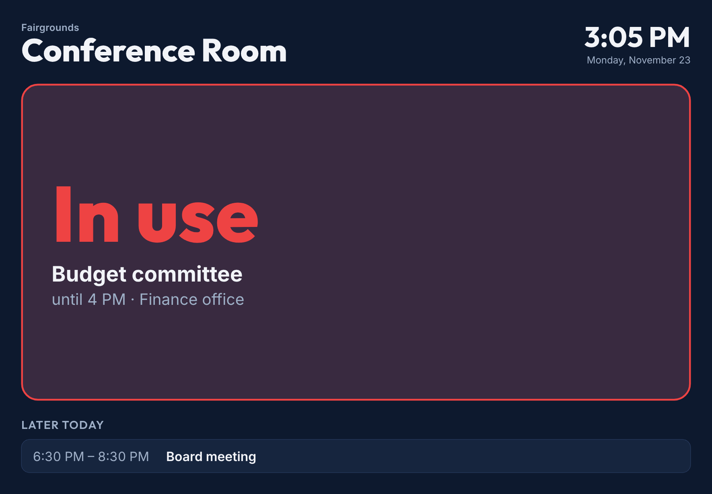<br><b>Room screen</b>: a tablet outside a meeting room shows if it's free.</td>
<td>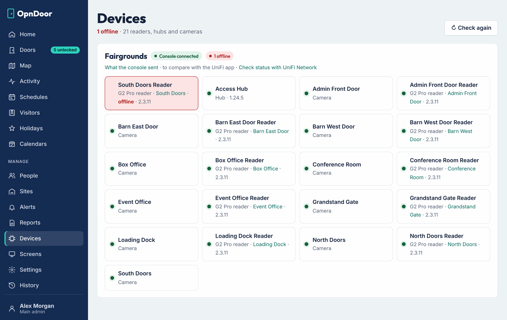<br><b>Devices</b>: every reader, hub and camera, offline ones first.</td>
</tr>
<tr>
<td>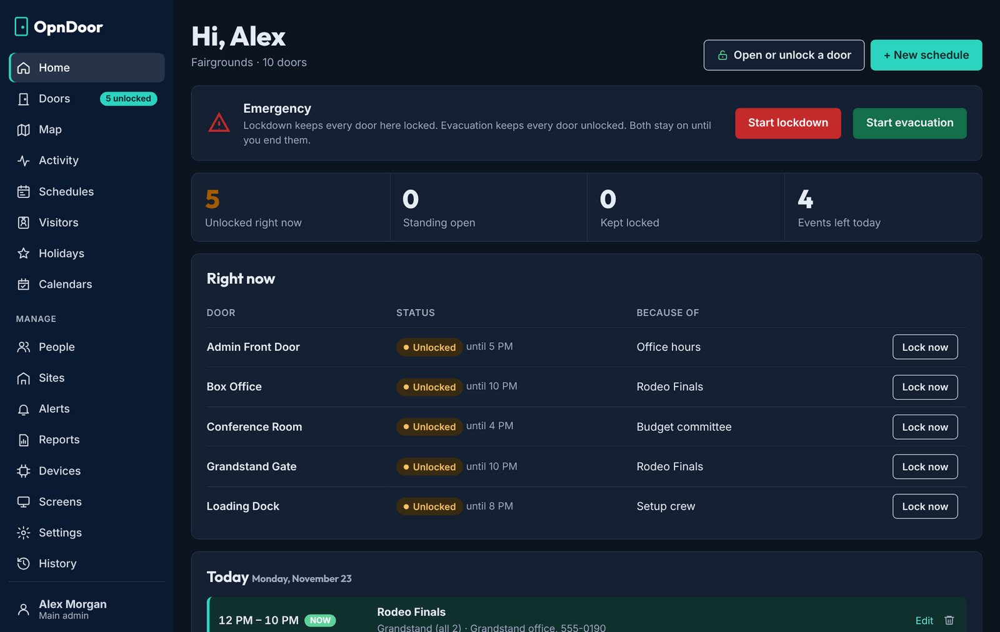<br><b>Dark mode</b>, automatic or by choice.</td>
<td align="center">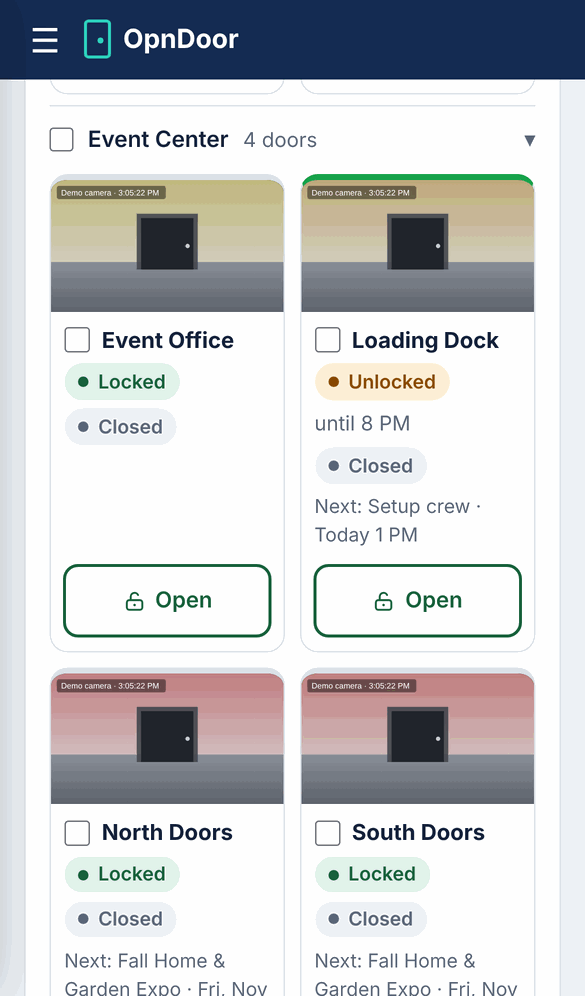<br><b>Phones</b>: open a door from wherever you are.</td>
</tr>
</table>

<sub>Screenshots use a demo site; names and numbers are made up.</sub>

## Features

- **Regular hours + overrides.** Give each door its normal weekly unlocked hours. Then add
  overrides on top: an event that unlocks it, or a closure that keeps it locked. While an
  override is on, it completely replaces the regular hours; when it ends, the regular hours
  resume. If overrides overlap, the most recently added one wins. Each door's page shows the
  next 7 days with everything applied.
- **Multiple sites / consoles.** Add each UniFi Access console as a site with its own address,
  API token and timezone. Doors are grouped by site everywhere, and schedule times are local to
  each door's site.
- **Three roles.**
  - **Admin**: everything, at every site, including adding sites (consoles) and other admins.
  - **Site admin**: runs the sites they're given: all doors there, the door operators there,
    calendars that use those doors, and history for those sites. Can't see other sites.
  - **Door operator**: sees and schedules only the doors they're given, either *all doors at a
    site* (including doors added later) or single doors. Never sees other sites.

  If a door operator works at two sites, each site admin can change only that person's access at
  their own site; name, email and sign-in can then only be changed by an admin.
- **Sign in with Microsoft** (work accounts), or with a password.
- **History.** Every change is recorded: who, when, and what changed (before → after), in plain
  English. Filter by person, site, door, type of change or date, and download it as a spreadsheet.
  Each door's page also shows its recent changes.
- **Events at a glance.** Each override says what it's for (🎉 Event, 👥 Meeting, 🔑 Rental, 📚 Class,
  🔧 Maintenance, 🚫 Closure), with an optional contact person.
- **Easy scheduling.** On the Doors page, tick the doors, then **Set regular hours** or **Add override**.
  Weekly repeats (any weekdays, optional end date) and overnight windows are supported.
- **Unlock now** for 15 min to 2 hours, straight from the home page.
- **Calendar automation.** Each booking becomes an unlock override. Add any iCal (.ics) link (Google Calendar, Outlook / Microsoft 365,
  booking systems). Rules map bookings to doors by text in the title, location or description
  (e.g. location contains "Fellowship Hall" → Fellowship Hall + Side Door), with unlock-early /
  lock-late padding. Moved or cancelled bookings update automatically. **Preview** shows what a
  calendar will do before it does it.
- **Activity log** of every schedule change, unlock, lock and error.
- **Visitor passes** with a PIN or QR code for chosen doors and times, emailed to the visitor, plus
  **lobby and room screens** for a tablet (see below).

## How door control works

For each door, OpnDoor builds a timeline from its schedules:

1. An active **override** decides: unlocked or kept locked (newest override wins).
2. Otherwise, during **regular hours**, the door is unlocked.
3. Otherwise OpnDoor leaves the door on its normal UniFi rule (locked).

Every 30 seconds it compares that with what it last told each console, through the UniFi Access
developer API (`PUT /api/v1/developer/doors/{id}/lock_rule`):

| Door should be | Command | Notes |
| --- | --- | --- |
| Unlocked until T | `custom`, interval = minutes until T | The console relocks by itself at T, even if OpnDoor is down. Back-to-back periods (e.g. regular hours running into an event) are sent as one unlock. |
| Kept locked | `keep_lock` | Also overrides unlock schedules set up inside UniFi Access itself. |
| Back to normal | `reset` | Sent when an override or unlock ends early, is deleted, or a lock override ends. |

After a restart it catches up on whatever should be happening now. Doors are listed with
`GET /api/v1/developer/doors` on each site's console every 10 minutes.

## Install

On a Linux machine (Ubuntu, Debian, Raspberry Pi OS, etc.) that can reach your UniFi Access console:

```bash
curl -fsSL https://raw.githubusercontent.com/Stevy2191/OpnDoor/main/install.sh | sudo bash
```

The installer does everything except sign in for you:

1. Installs Docker if it's missing.
2. Checks which ports are already in use and only picks free ones.
3. Asks how people should reach OpnDoor:
   - **Secure (HTTPS) with a built-in certificate** (recommended). Adds Caddy with a self-signed
     certificate. Browsers show a one-time warning; install `opndoor-certificate.crt` from the
     install folder on your computers to remove it.
   - **Your own reverse proxy** (nginx, Traefik, Nginx Proxy Manager, Cloudflare Tunnel...).
     OpnDoor listens on a local port for your proxy to forward to.
   - **No HTTPS**, for testing only.
4. Connects your UniFi Access console (and tests the API token), or skips it so you can add
   consoles later under **Sites**.
5. Optionally turns on live camera video and the **Update now** button.
6. Opens the firewall port if `ufw` or `firewalld` is on, downloads OpnDoor and starts it.

At the end it prints the web address and a **setup code**. Open the address, enter the code and
create your account: that first account is the **main admin**, which nobody else can change or remove.
Everything else (Microsoft sign-in, email, branding, backups) is set up in OpnDoor under **Settings**.

Everything lives in `/srv/docker/opndoor` (settings in `.env`, data in `data/`).

| To... | Run |
| --- | --- |
| Update to the newest version | **Settings → Updates → Update now** in OpnDoor, or `sudo /srv/docker/opndoor/update.sh` |
| Change settings (HTTPS, ports, live video, Update button) | the install command again → *Change settings* |
| Uninstall (keeps data unless you say otherwise) | the install command again → *Uninstall* |
| See logs | `cd /srv/docker/opndoor && sudo docker compose logs -f` |

Re-running the installer never touches your schedules, people or history.

### How the image is built

GitHub Actions (`.github/workflows/docker.yml`) runs the tests and checks the installer on every
push and pull request. On every push to `main` it builds the Docker image for regular PCs and
servers (amd64) and ARM boards like the Raspberry Pi 4/5 (arm64), and publishes it to GitHub's
container registry as `ghcr.io/stevy2191/opndoor:latest` (plus a tag for the commit). Tagging a
release `v1.2.0` also publishes `1.2.0` and `1.2`.

After the first build, check that the package is public: GitHub → your profile → **Packages** →
**opndoor** → **Package settings** → **Change visibility** → Public. (If it's private, the installer
asks for a GitHub token with `read:packages` instead.)

### Manual install

Prefer to do it by hand? Copy `docker-compose.yml` and `.env.example` (as `.env`) into a folder,
fill in `.env`, create `data/` owned by uid 10001 (`sudo chown 10001 data`), then
`docker compose up -d`.

## Cameras and live video

Door cameras come from **UniFi Protect** (the UniFi Access API has no video).

1. In UniFi OS: Settings → Control Plane → Integrations → **Create API Key**.
2. In OpnDoor: Sites → your site → **Cameras (optional)** → paste the key. Fill in
   "Protect console address" only if Protect runs on a different console.
3. Click **Reload from UniFi** on the Doors page. Doors are matched to cameras by name;
   admins can pick a different camera on a door's page.

That gives each door a picture that refreshes every few seconds.

**Live video** needs a small helper container, [go2rtc](https://github.com/AlexxIT/go2rtc),
that turns the camera's stream into something browsers play. The installer asks about it.
On a manual install, put `go2rtc.yaml` next to `docker-compose.yml` and add to `.env`:

```
COMPOSE_PROFILES=live
LIVE_VIDEO_URL=http://go2rtc:1984
```

then run `docker compose up -d`. Tapping a camera picture shows live video, and opening a
door that has a camera shows it live straight away (handy for watching a bay door go up).
The helper has no published ports: browsers only talk to OpnDoor, which checks that the
person may use the door. Live views stop after 10 minutes (`LIVE_MAX_MINUTES`) unless
someone taps "Keep watching".

- **Behind Nginx Proxy Manager**, turn on **Websockets Support** for the OpnDoor proxy host
  (Caddy, from the installer, handles it automatically).
- Browsers play H.264. If a camera uses Protect's **Enhanced** encoding (H.265), set it to
  Standard, or that door shows refreshing pictures instead.
- OpnDoor asks Protect for the camera's low-quality stream, turning it on if needed.

## Visitor passes and screens

**Visitors** (left menu) makes a pass for someone coming in: pick the doors and the time, and UniFi
Access gives them a PIN and/or QR code that only works on those doors during the visit. OpnDoor can
email it to them. The Visitors page lists today's visitors as expected, here or gone, and you can
print it. Cancelling a pass removes it from UniFi Access straight away.

- The Access API token needs **Visitor: Edit**. QR codes need UniFi Access 3.3.10 or later.
- To email passes, an admin sets up an email account under **Manage → Email** (Microsoft 365, Gmail
  or any mail server; Microsoft 365 needs Authenticated SMTP turned on for that mailbox, and
  accounts with multi-factor sign-in need an app password).

**Screens** (Manage → Screens) are pages for a tablet or TV on a private link, with no sign-in. They
can't open doors.

- **Lobby screen:** welcomes today's visitors by first name and last initial. A visitor taps their
  name to check in, and whoever they're seeing gets an email.
- **Room screen:** for outside a meeting room. Shows **Available** or **In use** with the meeting's
  name and end time, plus the rest of today's meetings, from the schedules and calendars on that
  room's door.

If a screen's link gets out, use **New link** and the old one stops working.

## Schedules already in UniFi Access

UniFi Access's API doesn't hand out a door's own **Unlock Schedule**, but it does say what each door is
doing right now. OpnDoor checks every minute and records when UniFi itself (not OpnDoor) has a door
unlocked on its schedule, or set in the UniFi app. From that it learns each door's weekly UniFi
pattern (for example "Mon–Fri 7 AM–6 PM") and shows it:

- on the door's page (**Also set in UniFi Access**), and as a **UniFi schedule** tag on the Doors page;
- as striped **UniFi unlock schedule** blocks in the Schedules week;
- as a warning on the schedule form when you pick a door UniFi also unlocks.

While an OpnDoor schedule is on, it takes over the door; when it ends, UniFi's schedule is back in
charge. The simplest setup is to move those hours into OpnDoor (**Set regular hours**) and clear the
Unlock Schedule in UniFi. Holidays set up in UniFi Access can be brought over under
**Holidays → See UniFi's holidays**.

## Alerts and reports

**Alerts** (Manage → Alerts) email the people you pick when something happens. Nothing is on by
default: an alert only exists once someone makes it, and it stays off until they switch it on. Each
alert has its own sites and doors, days and hours (overnight windows work), and recipients: OpnDoor
people plus any other addresses, such as a carrier's email-to-text address for a text message.

| Alert | When it fires |
|---|---|
| Door left open | the door sensor says it has stood open longer than N minutes |
| Turned-away badges | N turned-away attempts at one door within M minutes |
| Someone opens a door | every opening of the picked doors (set hours for an after-hours alert) |
| Device offline / Console unreachable | a reader, hub, camera or console stops answering for N minutes |
| Lockdown or evacuation | one starts, in OpnDoor or the UniFi Access app |
| Door didn't follow its schedule | OpnDoor couldn't apply a schedule |
| Visitor arrived / Visitor didn't come | a visitor checks in or uses their pass / a pass ends unused |

Each thing is sent once, and the Alerts page lists what went out recently.

**Reports** (Manage → Reports) email a daily, weekly or monthly summary to the people you pick, with
the sections you choose: door activity, visitors, alerts, offline devices, changes (and who made
them) and what's coming up. **Preview** shows it in the browser; **Send now** sends it straight away.

## Admin tools

- **Devices** (Manage → Devices): every console, reader, hub and Protect camera per site, with
  anything offline shown first in red. Needs the token's **Device: View**. UniFi Access's API sometimes
  reports a device's online state wrong (seen with Intercom Viewers); turn on **UniFi Network** in the
  site's connection settings and OpnDoor checks each device by MAC address in UniFi Network instead,
  and shows its IP. That needs a read-only UniFi OS API key for the console that runs UniFi Network.
- **People in UniFi Access** (People → People in UniFi Access): give someone a new PIN (optionally
  emailed to them) or turn all their access off and back on, without the UniFi app. Needs
  **People & Groups: Edit** and **Credentials: Edit** on the token.
- **Settings → Branding:** your logo, name and colours, used on every page, the sign-in page,
  lobby and room screens and visitor emails.
- **Settings → Backups:** a backup every night (keeps the last 14 by default) in `data/backups`,
  plus **Back up now**, download, and restore (from a saved backup or an uploaded file). A backup
  of the current data is always made before a restore or an update.
- **Settings → Updates:** shows the running and newest version, with an **Update now** button
  and optional automatic updates at night. The button needs the small `updater` helper next to
  OpnDoor: run the installer again, choose *Change settings*, and answer **Yes** to "Turn on the
  Update button". The helper is allowed to use Docker, and only ever pulls and restarts OpnDoor.

## Sign in with Microsoft

Set it up in OpnDoor under **Settings → Sign-in** (admins). The page walks through it:

1. In <https://entra.microsoft.com> → **App registrations** → **New registration**: name `OpnDoor`,
   *Accounts in this organizational directory only*, redirect URI platform *Web* with the address
   the Sign-in page shows (it updates as you type OpnDoor's address). Microsoft requires `https://`,
   so OpnDoor needs to be behind a proxy with a certificate first.
2. Copy the **Directory (tenant) ID** and **Application (client) ID** from the app's Overview page,
   and a new client secret's **Value**, into the Sign-in page. Save.
3. Add each person under **People** with the email they use for Microsoft and choose *Microsoft
   account*. Only people added there can sign in. Accounts outside your tenant can't.

Settings from an older install's `.env` (`MS_TENANT_ID`, `MS_CLIENT_ID`, `MS_CLIENT_SECRET`,
`PUBLIC_URL`) still work; once you save them on the Sign-in page, those are used instead.
Secrets expire, so paste a new one before the old one does.

## NFC cards

**People → People in UniFi Access → Cards** shows a person's cards and adds new ones: pick a reader
you're next to, press **Start**, and tap the card within a minute. OpnDoor gives it to that person in
UniFi Access. Cards can be removed there too. The API token needs **Credentials: Edit** and
**Device: View**.

Keep at least one admin with a password, so you can still get in if the Microsoft settings change.

## Security

- The image is **distroless** (Python and its libraries only: no shell, package manager or system tools)
  and runs as a non-root user. It's rebuilt every week so Debian and Python security fixes arrive even
  when OpnDoor hasn't changed, and Dependabot proposes package updates. Every build checks the Python
  packages with `pip-audit`.
- Pages can't be shown inside another site's frame, and form posts from other websites are refused
  (on top of the SameSite session cookie).
- Password sign-in pauses after 5 wrong tries for an account (or 20 from one address) in 15 minutes.
- Calendar links can't point inside the server (localhost, the helper containers, cloud metadata
  addresses); they're limited to 10 MB and checked again on every redirect.
- If port 8080 is reachable without your proxy, set `FORWARDED_ALLOW_IPS` in `.env` to the proxy's
  address so nobody else can claim to be forwarding for another visitor.
- Backups contain your UniFi API tokens and email password: keep downloaded copies safe.

## Local development

```bash
pip install -r requirements-dev.txt
pytest
DATA_DIR=./data uvicorn app.main:app --reload --port 8080
```

## Layout

| Path | What |
| --- | --- |
| `app/main.py` | App setup, background jobs |
| `app/web.py` | Pages and form handling |
| `app/engine.py` | Reconcile loop (timelines → door commands), site/door sync, audit log |
| `app/schedules.py` | Repeat expansion, default/override timeline, time zones |
| `app/calendars.py` | ICS fetching, rule matching, booking → schedule sync |
| `app/unifi.py` | UniFi Access API client (one per site) and the demo console |
| `app/models.py` | Database tables |
